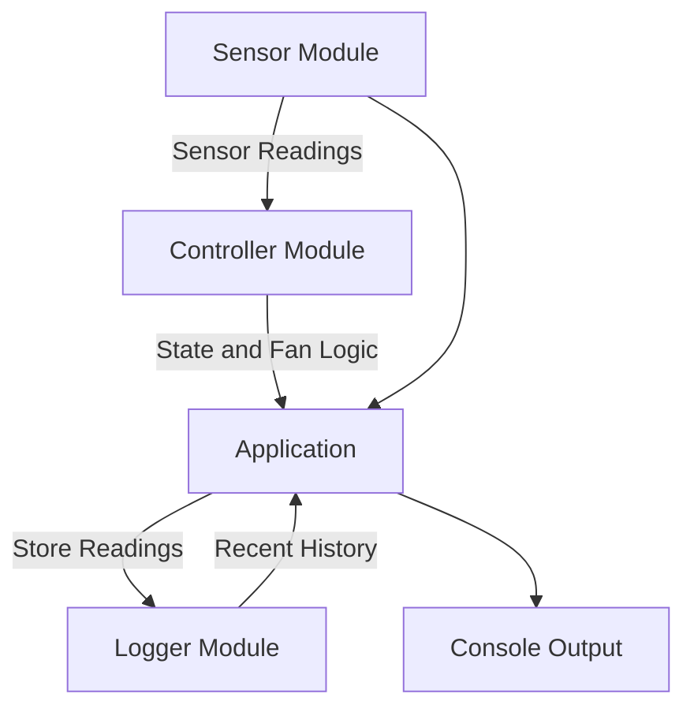

# Embedded Sensor Monitoring & Control System


A modular C++17-based embedded system simulation that monitors environmental sensor readings, evaluates operating conditions using threshold-based control logic, and maintains recent readings using a fixed-capacity circular buffer.

The project demonstrates modular software design, state-based control logic, data management, unit testing, build automation, and continuous integration.

## Overview

The Embedded Sensor Monitoring & Control System simulates an environmental monitoring system that collects temperature and humidity readings, evaluates temperature thresholds, and determines whether a cooling mechanism should be activated.

The application simulates sensor data and a fan actuator, allowing the system's behavior to be tested without physical hardware.

## Features

- **Sensor Simulation:** Generates randomized temperature and humidity readings within predefined ranges.
- **Threshold-Based Control:** Classifies temperature conditions into NORMAL, WARNING, and CRITICAL states.
- **Simulated Actuator:** Activates or deactivates a fan based on the controller's evaluation.
- **Circular Buffer Logging:** Maintains the most recent 10 sensor readings while preserving chronological order.
- **Modular Architecture:** Separates sensor generation, control logic, logging, and application execution.
- **Unit Testing:** Includes dedicated tests for sensor, controller, and logger functionality.
- **Build Automation:** Uses CMake to configure and build the project.
- **Continuous Integration:** GitHub Actions automatically builds the project and runs tests on pushes and pull requests to the main branch.

## System Architecture



### Modules

| Module | Responsibility |
|---|---|
| Sensor | Generates simulated temperature, humidity, and timestamp data. |
| Controller | Evaluates temperature and determines the system state and fan status. |
| Logger | Stores sensor readings in a fixed-capacity circular buffer. |
| Main Application | Integrates modules and displays readings, system states, fan status, and recent history. |

## Control Logic

The controller evaluates temperature readings against predefined thresholds.

| Temperature | System State | Fan |
|---|---|---|
| Below 30°C | NORMAL | OFF |
| 30°C to below 35°C | WARNING | ON |
| 35°C and above | CRITICAL | ON |

These thresholds are simulation parameters and are not intended for real-world safety or environmental control applications.

## Circular Buffer

The logger implements a fixed-capacity circular buffer with a capacity of 10 readings.

When the buffer is full, new readings overwrite the oldest entries. The logger provides access to stored readings in chronological order, even after the buffer wraps around.

This implementation demonstrates bounded memory usage and efficient storage management for a continuous stream of sensor data.

## Project Structure

```text
embedded-sensor-monitor/
├── .github/
│   └── workflows/
│       └── ci.yml
├── include/
│   ├── Sensor.hpp
│   ├── Controller.hpp
│   └── Logger.hpp
├── src/
│   ├── main.cpp
│   ├── Sensor.cpp
│   ├── Controller.cpp
│   └── Logger.cpp
├── tests/
│   ├── test_sensor.cpp
│   ├── test_controller.cpp
│   └── test_logger.cpp
├── CMakeLists.txt
├── .gitignore
└── README.md
```

## Technologies Used

- C++17
- CMake
- GCC
- Git and GitHub
- GitHub Actions
- CTest

## Build and Run

### Prerequisites

- GCC/G++ compiler
- CMake 3.16 or newer

### Build

Clone the repository:

```bash
git clone https://github.com/Pikachu-21/embedded-sensor-monitor.git
cd embedded-sensor-monitor
```

Configure the project:

```bash
cmake -S . -B build
```

Compile:

```bash
cmake --build build
```

### Run the application

```bash
./build/embedded_monitor
```

The application generates 15 simulated readings and displays their temperature, humidity, system state, and fan status, followed by the latest 10 readings stored in the logger.

## Testing

The project includes three dedicated test executables registered with CTest.

| Test Suite | Validates |
|---|---|
| SensorTest | Reading ranges and sequential timestamps across 1,000 generated readings. |
| ControllerTest | State transitions and fan activation/deactivation at defined thresholds. |
| LoggerTest | Buffer capacity, chronological ordering, wraparound behavior, and invalid index handling. |

Run the tests:

```bash
ctest --test-dir build --output-on-failure
```

### Test Results

All three test suites have been successfully executed locally.

- SensorTest: Passed
- ControllerTest: Passed
- LoggerTest: Passed

**3/3 test suites passed.**

## Continuous Integration

GitHub Actions automates the project's build and testing workflow.

On pushes and pull requests targeting the `main` branch, the CI pipeline:

1. Checks out the repository.
2. Configures the project using CMake.
3. Builds the application and test executables.
4. Executes the registered test suites through CTest.

The CI workflow has been successfully executed on GitHub Actions.

## Engineering Concepts Demonstrated

- Modular software architecture
- C++ classes, structures, and enumerations
- State-based control logic
- Fixed-capacity circular buffer implementation
- Bounded data storage
- Unit testing and test-driven validation
- CMake build configuration
- Compiler diagnostics using `-Wall`, `-Wextra`, and `-Wpedantic`
- Continuous integration using GitHub Actions

## Limitations and Future Improvements

The current implementation is a software simulation and does not interface with physical sensors or hardware.

Potential extensions include:

- Integration with physical sensors and microcontrollers.
- Hardware-level peripheral communication.
- Configurable thresholds and control parameters.
- Hysteresis-based control to prevent rapid switching around thresholds.
- Extended logging and error-handling mechanisms.
- Hardware-specific deployment and testing.

## Author

**Pikachu-21**

GitHub: [https://github.com/Pikachu-21](https://github.com/Pikachu-21)

